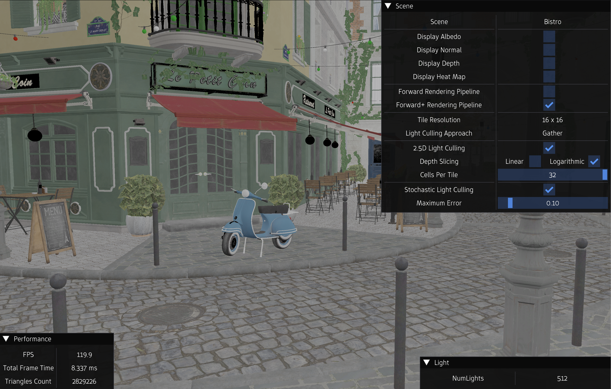
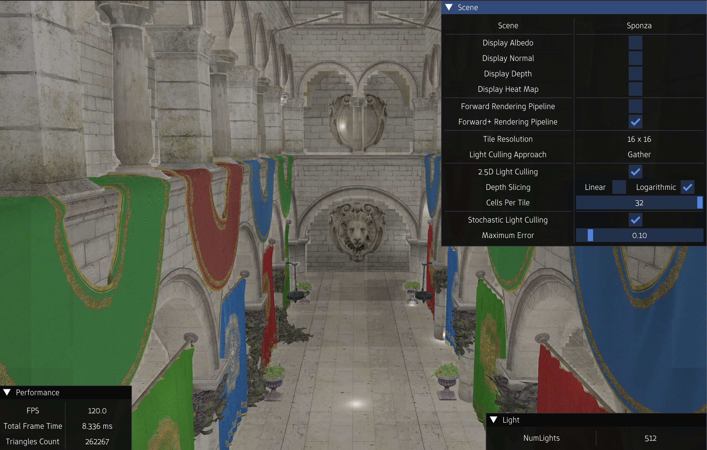
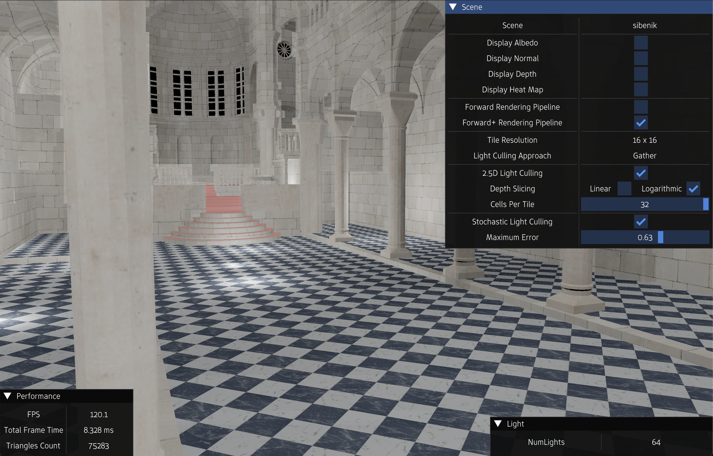

***I wrote a comprehensive blog explaining light culling in Vulkan in detail. Read it [here](https://amrhmorsy.github.io/blog/2026/LightCulling/).***

 
 
<h2>Light Culling Demo</h2>
 
 

  
     
  <i>Bistro scene</i>

 

  
     
  <i>Sponza scene</i>

 

  
     
  <i>Sibenik scene</i>

 

A real-time application in <b>C++</b> and <b>Vulkan</b> that demonstrates light culling. It features: 

- A simple shading model that supports lighting
- A simple UI with a performance panel displaying metrics such as FPS, triangles count, and time-per-frame.
- A simple UI for tweaking different parameters. The available parameters are:
  
    - A flag to display albedo
    - A flag to display normal
    - A flag to display depth
    - A flag to inspect heat map
    - A flag to enable and disable light culling
    - A flag to enable and disable 2.5D light culling
    - A knob to edit the number of depth cells per tile
    - A flag to enable and disable stochastic light culling
    - A flag to adjust stochastic parameters

 
 
